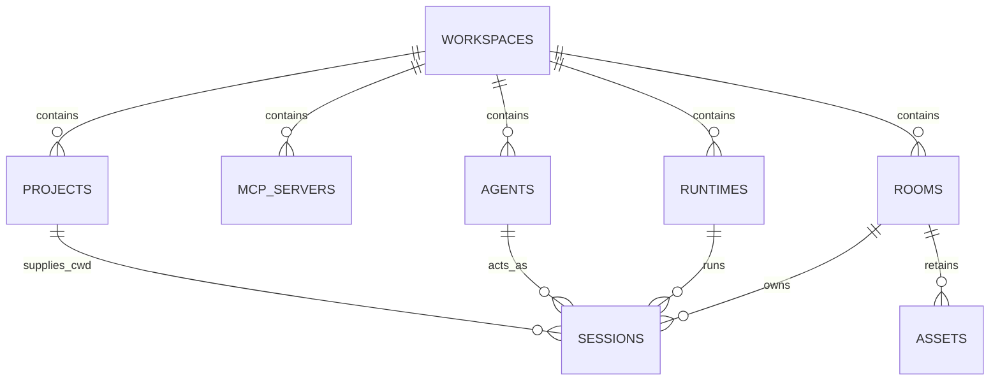

# Workspace-first 数据模型（精简版）

> 状态：**已固化并开始实现。** 旧关系表与旧会话表在首次加载新模型时会被一次性移除；不保留双写路径。
>
> 本版本刻意不使用对象目录、通用关系表、`room_*_links`、`*_scopes` 或资产关联表。项目、MCP、Agent、Runtime 都是 Workspace 的直接资源；Room 直接保存它这次工作所需的资源 ID。

## 1. 固定的产品边界

### Workspace

Workspace 是用户进入产品后选择的最小工作单位。它包含项目、MCP、Agent、Runtime 与 Room。

它不是一个工作目录。一个 Workspace 可以有一个项目，也可以有二十多个项目和一个知识库；单项目与跨项目没有不同的数据结构。

### Room

Room 是中间主舞台，也是唯一具有持续选中状态的左侧项目。

- 点 Project / MCP / Agent：只改变右侧检查器；
- 点 Room：切换中间的协作现场；
- 文件树与文件预览是 Project 的能力，不是 Room；
- Room 直接记录这次工作使用了哪些资源，不通过额外关联表间接表达。

### Pi 原生 Session

Pi 的 Session 是 Runtime 原生状态。平台保存它的稳定引用和生命周期，但不镜像完整 transcript，不接管工具状态、权限状态或上下文压缩。

每个 Pi 原生 Session 直接归属一个 Room，因此不需要 `room_sessions` 关系表。

## 2. 七张运行主体表，加一张可选资产表



| 表 | 责任 | 不是 |
| --- | --- | --- |
| `workspaces` | Workspace 的边界、基本配置和当前 UI 状态 | 项目目录、会话本体 |
| `projects` | 代码项目、知识库、外部系统等可工作资源 | Room 关联表 |
| `mcp_servers` | Workspace 的 MCP 配置 | Project 或 Agent 的子表 |
| `agents` | 角色、稳定指令、默认资源许可 | 一次执行实例 |
| `runtimes` | Pi 等运行时的连接与能力 | 原生 Session 本身 |
| `rooms` | 当前协作问题、选用资源、可读摘要 | Runtime 的私有上下文 |
| `sessions` | 所有 Agent 共用的、某个 Room 中实际运行的 Pi 原生 Session | 通用聊天消息表 |
| `assets` | 可交接、可审核的结论和证据 | 完整原生 transcript |

`assets` 是可选的第八张表：若第一版只需要 Pi 对话，可暂不创建它，运行主体只有前七张表。它不承担关系表职责，后续需要 Room 之间可追踪交接时再启用即可。

## 3. 每张表的字段

### 3.1 `workspaces`

```ts
type Workspace = {
  id: string;
  name: string;
  description: string | null;
  status: "active" | "archived";
  defaultRuntimeId: string | null;

  // 当前单用户 UI 状态；未来多用户再拆为 workspace_user_preferences。
  activeRoomId: string | null;
  inspector: {
    visible: boolean;
    kind: "project" | "mcp" | "agent" | null;
    resourceId: string | null;
    openFileRefs: string[];
    expandedTreePaths: Record<string, string[]>;
  };

  createdAt: string;
  updatedAt: string;
};
```

不再存在 `working_directory`。本地目录属于 Project。

### 3.2 `projects`

```ts
type Project = {
  id: string;
  workspaceId: string;
  name: string;
  kind: "code" | "knowledge" | "contract" | "external" | "environment";
  locationKind: "local_path" | "git_remote" | "api" | "none";
  localPath: string | null;
  sourceUri: string | null;
  accessMode: "read" | "write" | "managed";
  domain: string | null;
  configuration: Record<string, unknown>;
  status: "active" | "disabled" | "archived";
};
```

知识库 v2 可以作为 `kind: "knowledge"` 的 Project；它与代码项目同样是 Workspace 的一等资源，而不是系统级例外。

### 3.3 `mcp_servers`

```ts
type McpServer = {
  id: string;
  workspaceId: string;
  name: string;
  transport: "stdio" | "sse" | "streamable_http" | "in_process";
  connectionConfig: Record<string, unknown>;
  secretRef: string | null;
  capabilities: Record<string, unknown>;

  // 空数组表示可用于该 Workspace 的所有 Project。
  allowedProjectIds: string[];
  accessPolicy: "allow" | "approval" | "read_only";
  status: "ready" | "unavailable" | "disabled";
};
```

这里用 `allowedProjectIds` 直接表达 MCP 作用范围，不创建 `mcp_project_scopes`。

### 3.4 `agents`

```ts
type Agent = {
  id: string;
  workspaceId: string;
  name: string;
  roleKind: "system" | "project" | "specialist" | "reviewer";
  instruction: string;
  defaultRuntimeId: string | null;

  // 空数组表示不额外收窄 Workspace 默认范围。
  allowedProjectIds: string[];
  allowedMcpIds: string[];
  executionPolicy: Record<string, unknown>;
  status: "active" | "disabled" | "archived";
};
```

Agent 是角色定义。它可以限定默认项目和 MCP，但不能取代 Pi 原生 Agent/Session 的内部机制。

### 3.5 `runtimes`

```ts
type Runtime = {
  id: string;
  workspaceId: string;
  name: string;
  provider: "pi"; // 第一阶段固定 Pi
  connectionKind: "local_sdk" | "local_process" | "remote_service";
  configuration: Record<string, unknown>;
  capabilities: Record<string, unknown>;
  status: "ready" | "unavailable" | "disabled";
};
```

这张表不保存 Pi 的完整内部配置或认证秘密。它只让产品知道“在这个 Workspace 内有哪个可用 Pi Runtime”。

### 3.6 `rooms`

Room 直接记录本次协作的资源选择。

```ts
type Room = {
  id: string;
  workspaceId: string;
  title: string;
  problemStatement: string | null;
  summary: string | null;

  // 直接关联，不建立关系表。
  projectIds: string[];
  mcpIds: string[];
  agentIds: string[];
  runtimeId: string;

  // 哪一个 Agent 是下次发送消息时的默认执行者。
  activeAgentId: string;
  status: "active" | "paused" | "closed" | "archived";
  createdAt: string;
  updatedAt: string;
};
```

Room 的资源是**本次工作快照**：Room 创建后，即使 Workspace 再加了新项目，也不会自动进入当前 Room。需要时由用户显式加入 `projectIds` 等字段。

单项目 Room 就是 `projectIds` 只有一个元素；跨四个项目的分析就是该数组有四个元素。

### 3.7 `sessions`

```ts
type Session = {
  id: string;
  workspaceId: string;
  roomId: string;
  runtimeId: string;
  agentId: string;
  cwdProjectId: string | null;

  // Pi SessionManager 返回的 session 文件路径或稳定引用。
  nativeSessionRef: string | null;
  nativeMetadata: Record<string, unknown>;
  purpose: string | null;
  state: "not_started" | "active" | "idle" | "ended" | "unavailable";
  createdAt: string;
  lastActivityAt: string | null;
};
```

Room 可直接拥有多个 Native Session：例如同一 Room 中，一个 Pi Agent 在 `knowledge-v2` 做检索，另一个在某代码项目执行修改。它们各自独立、各自保留 Pi 原生上下文，不需要中间绑定表。

### 3.8 `assets`（建议保留，第一版可延后）

```ts
type Asset = {
  id: string;
  workspaceId: string;
  roomId: string;
  sourceNativeSessionId: string | null;
  kind:
    | "evidence"
    | "fact"
    | "hypothesis"
    | "decision"
    | "deliverable"
    | "reference";
  title: string;
  body: string;
  provenance: Record<string, unknown>;
  scope: "room" | "workspace";
  status: "draft" | "accepted" | "superseded" | "retracted";
  createdAt: string;
};
```

资产不再有 `asset_links`。如果需要指向文件、项目、MCP 结果或其他证据，把稳定引用直接写入 `provenance`：

```ts
{
  projectId: "project-knowledge-v2",
  fileRef: "docs/architecture.md#L80-L120",
  nativeSessionId: "session-01",
  toolCallRef: "pi-tool-call-42"
}
```

## 4. 不设关系表后的约束

减少表意味着数组中的外键不能由 SQLite 自动保证。因此以下规则必须由服务层在一次事务中验证：

1. `Room.projectIds`、`mcpIds`、`agentIds`、`runtimeId` 中的全部 ID 必须属于同一个 `workspaceId`；
2. `Room.activeAgentId` 必须属于 `agentIds`；
3. `Session.roomId`、`runtimeId`、`agentId`、`cwdProjectId` 必须和该 Room 的 Workspace 一致；
4. Session 所使用的 `agentId` 必须在 Room 的 `agentIds` 内；其 `runtimeId` 必须等于 Room 的 `runtimeId`；
5. Session 的 `cwdProjectId` 必须在 Room 的 `projectIds` 内；
6. Room 选用 MCP 时，必须同时满足 Agent 的 `allowedMcpIds` 和 MCP 的 `allowedProjectIds` 限制；
7. 禁止把整个 Pi transcript 或工具私有状态写进 `Room.summary`、`nativeMetadata` 或 JSON 数组字段。

这是精简模型的明确取舍：读 Room 很简单，写入时必须经过统一的校验服务。对于当前单用户、单 Workspace 页面，这是更合适的成本结构。

## 5. Pi-only 第一阶段流程

```text
创建 Workspace
  └─ 仅创建 Runtime(Pi) / 默认 Agent
       └─ 用户按需添加 Project / MCP
            └─ 创建 Room
            ├─ 直接写入 projectIds / mcpIds / agentIds / runtimeId
            └─ 首次发送消息
                 └─ 创建 Session(roomId, agentId, runtimeId, cwdProjectId)
                      └─ Pi 创建或恢复原生 Session
                           └─ 必要时沉淀 RoomAsset
```

Room 标题可在第一轮有效响应后自动总结。Agent 在某个 `Session` 开始后保持不变；若用户想换 Agent，不修改原会话，而是在同一个 Room 中新建一个 Session，并让 `activeAgentId` 指向新 Agent。

## 6. 实施顺序

1. 新建这七张主体表（若暂不做资产，先建六张）；
2. 给 `rooms` 实现统一的资源引用校验；
3. 实现 Workspace 创建、切换和直接资源管理；
4. 用统一的 `sessions` 表重接 Pi；
5. 最后接右侧检查器与文件预览的 `workspaces.inspector` 状态；
6. 完成验证后再迁移和清理旧原型表。

旧原型表不再是迁移来源，也不会再被读取或写入。
